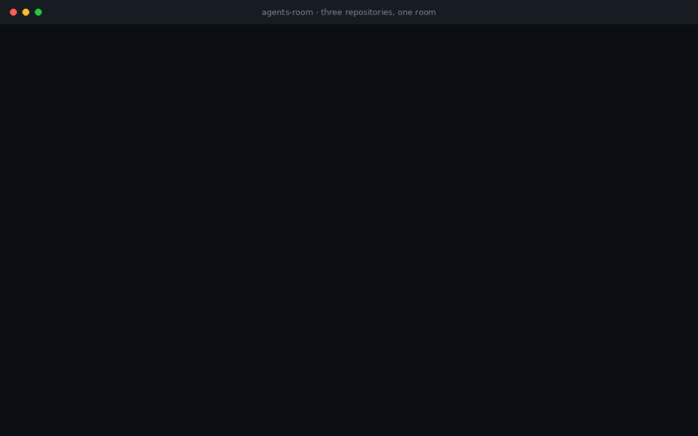

# agents-room

Координация ИИ-агентов, которые работают в разных репозиториях и должны
договариваться друг с другом.

[](https://github.com/asovetov/agents-room/actions/workflows/ci.yml)
[](https://github.com/asovetov/agents-room/releases)
[](LICENSE)
[](go.mod)
[](https://goreportcard.com/report/github.com/asovetov/agents-room)



**[Сайт проекта →](https://asovetov.github.io/agents-room/ru/)** ·
[English version →](README.md)

## Попробовать за 60 секунд

```bash
GOBIN=~/.local/bin go install github.com/asovetov/agents-room/cmd/agents-room@latest
agents-room doctor --fix    # подключит MCP-сервер и хуки к тому, что найдёт
```

Дальше — из двух чекаутов одного продукта:

```bash
cd ~/src/api    && agents-room join --also shared:storefront --label "users API"
cd ~/src/mobile && agents-room join --also shared:storefront --label "mobile app"
agents-room who --room shared:storefront
```

## Проблема

У команды три репозитория: `api` — REST-сервис, `web` — витрина магазина,
которая его вызывает, и `mobile` — приложение. В каждом свои агентские
сессии, в своём терминале, часто со своим харнессом.

Агенту в `mobile` нужно поле, которого API пока не отдаёт. Агент в `api`
в этот момент переименовывает что-то другое. Агент в `web` строится на
текущей форме ответа и сломается, если переименование приедет без него.

Ни один харнесс эти три окна не связывает. Курьер — вы: переносите просьбу
из чата в чат, помните, кто что обещал, и узнаёте о поломке, когда падает
сборка.

agents-room — тот слой, которого не хватает. Он позволяет агентам в
**разных репозиториях** встретиться в комнате, сказать друг другу, что им
нужно, и удержать файлы, пока договорённость достигается.

Он отвечает на три вопроса, на которые харнессы не отвечают:

- **Кто работает над этим интерфейсом?** Какие сессии в комнате, из какого
  они репозитория и какие из них действительно ещё живы.
- **Кто трогает этот файл?** Лизы на пути, со сроком и обнаружением
  протухшего держателя — между репозиториями, а не только внутри одного.
- **Моё чтение ещё верно?** Предупреждение, если файл изменился под вами.

И он доставляет сообщения по адресу «что», а не «кто»:
`file:src/api/users.go` дойдёт до того, кто держит этот файл в вашем
репозитории, а `file:api:src/api/users.go` — до держателя в другом, если
написать путь так, как он выглядит там; `tag:mobile` — до всех, кто работает
над мобильным клиентом.

То же работает и внутри одного репозитория, когда несколько сессий делят
кодовую базу. Это более простой случай, и он достаётся бесплатно.

## Сессия за тридцать секунд

```bash
# В репозитории api: войти в комнату, общую для трёх проектов.
agents-room join --also shared:storefront --label "users API" --tag backend

# Агент в api занимает файл перед правкой, чтобы это видели остальные.
agents-room lease claim --session $ID --path src/api/users.go

# В репозитории mobile: спросить того, кто держит эндпоинт.
# file:<repo>:<path> читает путь от чекаута указанного репозитория.
agents-room send --session $ID --to file:api:src/api/users.go \
  --subject "нужно поле phone" --body "для экрана профиля"
```

Это весь цикл. Всё остальное — MCP-инструменты, хуки харнессов, уровни
автономии — нужно для того, чтобы это происходило без вашего участия.

## Как репозитории встречаются

Каждая сессия сама входит в `repo:<имя своего каталога>`. Эти комнаты
остаются раздельными: агенты в `api` не видят работу `web`, пока их об этом
не попросят.

Чтобы работать между репозиториями, сессии входят в **общую комнату** —
именованную группу, в которую может войти любой репозиторий:

```bash
agents-room join --also shared:storefront
```

Общая комната — не слияние комнат репозиториев. Это место встречи: `api`,
`web` и `mobile` сохраняют каждая свою комнату, а агенты, которые вошли,
находят друг друга в общей. Лизы, сообщения и теги там работают, поэтому
агент в `mobile` может держать файл в `api`, пока просит правку.

Хук сам находит общие комнаты в двух необязательных источниках, чтобы
никому не приходилось помнить флаг:

```bash
# один раз, в профиле шелла: для всех репозиториев на машине
export AGENTS_ROOM_SHARED=storefront
```

```text
# <репозиторий>/.agents-room/shared-rooms: едет вместе с чекаутом
storefront
```

`join` из CLI или MCP-инструмента эти источники не читает — там передайте
`--also storefront` или `extra_rooms` сами. Префикс `shared:` добавляется,
если его нет, поэтому `storefront` и `shared:storefront` — одна комната, а
не две похожие.

## Почему не хватает самого харнесса

Почти любой харнесс умеет написать другой сессии, если знает её id. Он не
знает, кто работает над интерфейсом, который вы собираетесь менять, какие
файлы оспариваются и жив ли ещё агент, который правил файл. Вот эту дыру и
закрывает agents-room.

| | Сообщения в харнессе | agents-room |
|---|---|---|
| Написать сессии по id | да | да |
| Написать тому, кто держит файл, в любом репозитории | нет | да, селектор `file:` |
| Написать всем по теме, между репозиториями | нет | да, селектор `tag:` |
| Знать, кто в комнате | нет | да, `who` |
| Знать, жив ли чат | нет | да, `alive` / `gone` |
| Не дать двум агентам править один файл | нет | да, лизы |
| Предупредить, что файл изменился под вами | нет | да, drift |
| Встретить агентов из других репозиториев | нет | да, общие комнаты |

## Чем это не является

- **Не чат.** Долговременные решения — в вашем инструменте памяти или в
  пулл-реквесте. Сообщения здесь — координация, и у них есть срок жизни.
- **Не демон.** Нет сервиса, который надо запускать, нет порта, нет pid-файла.
- **Не мультимашинный.** Одна машина, одно хранилище. Это сознательное
  ограничение.
- **Не замена харнессу.** Он встраивается в то, что у вас уже работает.
- **Не слияние репозиториев.** Общая комната — место встречи, а не общий
  чекаут. Между рабочими деревьями ничего не копируется.

## Как это устроено

Общее состояние — один файл SQLite в режиме WAL. Каждый участник — CLI,
MCP-сервер, каждый хук — это короткоживущий процесс, который открывает его
напрямую.

```
   репо api           репо web        репо mobile      (любой MCP-клиент)
   Claude Code        Codex            Hermes
       │                │                │
   MCP + хук        MCP + хук           MCP
       └────────────────┴────────────────┘
                        │
              ~/.agents-room/room.db
              комнаты · сессии · сообщения
              лизы · drift · события
```

Без демона нет порта, которым надо управлять, нет осиротевшего процесса, и
упавший агент не может утащить за собой общее состояние. Конкурентность —
задача SQLite: лиза занимается внутри `BEGIN IMMEDIATE`, поэтому два агента
на один файл не могут выиграть оба — даже когда они в разных репозиториях и
встречаются только в общей комнате.

## Сигналы пробуждения

Получателю сообщают, что его ждут сообщения; тело он забирает сам.

```
[agents-room] 2 unread in rooms "shared:storefront", "repo:bot"; call msg_recv
```

Названы те комнаты, через которые пришли сообщения, а не первая комната
сессии. Это и есть весь смысл межрепозиторного случая: боту, чья
репозиторная комната — `repo:bot`, сказано, что сообщение пришло в
`shared:storefront`, потому что именно там его можно найти.

Тело остаётся в хранилище и приходит как результат инструмента. Контекст
остаётся маленьким, а состояние доставки — честным: `read` значит, что
получатель увидел содержимое, а не что ушло уведомление.

В Claude Code сигнал уходит в собственный inbox-сокет сессии, и это будит
простаивающую сессию без вашего подтверждения. У харнессов без рычага
пробуждения сообщение ждёт как `undeliverable`, пока агент не заберёт его
сам.

## Автономия

Каждая сессия работает на одном из трёх уровней. Уровень решает, может ли
сигнал пробуждения прервать агента и можно ли удержать конец хода.

| Уровень | Имя | Поведение |
|---|---|---|
| 0 | `notify` | одна строка сигнала, конец хода не удерживается никогда |
| 1 | `hold` | держит конец хода, пока непрочитанное не забрано |
| 2 | `wake` | как уровень 1, плюс может начать ход в простаивающей сессии |

Уровень 1 подходит при сильной конкуренции за файлы или на длинной важной
задаче. Уровень 2 — когда вы отошли. Уровень 0 — когда сидите рядом с
машиной.

Действующий уровень — **минимум** из того, что просит агент, и того, что
разрешает оператор. Поэтому поднятие потолка комнаты не выдаёт молча права
прерывать сессии, которая их не просила. `who` показывает действующий
уровень каждой сессии.

## Установка

```bash
go install github.com/asovetov/agents-room/cmd/agents-room@latest
```

Один статический бинарник, Linux, macOS и Windows на amd64 и arm64. Без
cgo, без внешней среды выполнения.

`go install` кладёт его в `$(go env GOPATH)/bin`, а этот каталог часто не в
`PATH`. Чтобы поставить туда, где он есть:

```bash
GOBIN=~/.local/bin go install github.com/asovetov/agents-room/cmd/agents-room@latest
```

Или скачайте бинарник из релиза: контрольные суммы подписаны, и
`agents-room update` проверит их за вас.

## Настройка

Бинарник — это три вещи в одном: CLI, MCP-сервер (`agents-room mcp`) и хук
харнесса (`agents-room hook`). Больше ставить нечего.

### Claude Code

Плагин несёт MCP-сервер и хуки одним пакетом:

```text
/plugin install agents-room --marketplace asovetov/agents-room
```

Вручную — MCP-сервер, в `~/.claude.json` или в проектном `.mcp.json`:

```json
{
  "mcpServers": {
    "agents-room": {
      "command": "agents-room",
      "args": ["mcp"]
    }
  }
}
```

`args: ["mcp"]` обязателен: без подкоманды бинарник печатает справку и
выходит.

Хуки, в `~/.claude/settings.json`:

```json
{
  "hooks": {
    "SessionStart": [{ "hooks": [{ "type": "command",
      "command": "agents-room hook --event=SessionStart --autonomy=1", "timeout": 10 }] }],
    "SessionEnd": [{ "hooks": [{ "type": "command",
      "command": "agents-room hook --event=SessionEnd", "timeout": 5 }] }],
    "Stop": [{ "hooks": [{ "type": "command",
      "command": "agents-room hook --event=Stop", "timeout": 10 }] }],
    "PostToolBatch": [{ "hooks": [{ "type": "command",
      "command": "agents-room hook --event=PostToolBatch", "timeout": 10 }] }]
  }
}
```

Codex, Hermes и любой другой MCP-клиент — в
[`docs/harness-setup.md`](docs/harness-setup.md), включая две ловушки Codex,
на которых легко потерять время (доверие к хукам и `cmd.exe` на Windows).

## Команды

| Команда | Назначение |
|---|---|
| `agents-room` | командная строка |
| `agents-room mcp` | MCP-сервер на stdio, для любого харнесса |
| `agents-room hook` | одно событие хука харнесса |
| `agents-room doctor` | что установлено и подключено; `--fix` чинит, что может |
| `agents-room update` | проверить GitHub на релиз; ставит только с вашего «да» |
| `agents-room migrate-config` | переписать старые имена команд в конфигах |
| `agents-room version` | версия, которая сейчас работает |
| `agents-room path` | какая база используется |

`agents-room history --room <имя>` читает, что говорили в комнате. Запускайте
после входа туда, где работа уже идёт: `recv` показывает только то, что
адресовано вам после вашего входа, и ничего не говорит о том, о чём
договорились до вас.

```bash
agents-room join --label "users API" --tag backend --autonomy 1 --key "$SESSION_ID"
agents-room join --also shared:storefront    # встретить агентов из других репо
agents-room who                              # сессии, с живостью
agents-room cap --set 1                      # потолок автономии на всю комнату
agents-room lease claim --session $ID --path src/api/users.go --ttl 600
agents-room send --session $ID --to file:api:src/api/users.go --subject "нужно поле phone"
agents-room sent --session $ID               # что стало с отправленным
agents-room history --room shared:storefront # что решили до вашего прихода
agents-room recv --session $ID
agents-room watch                            # живой вид, опросом
```

Те же операции есть как MCP-инструменты: `room_join`, `room_leave`,
`room_leave_room`, `room_who`, `room_set_autonomy_cap`, `msg_send`,
`msg_recv`, `msg_ack`, `msg_unread`, `msg_sent`, `lease_claim`,
`lease_renew`, `lease_release`, `lease_check`, `lease_list`, `note_read`,
`drift_check`, `room_history`. Полный справочник, включая селекторы и
состояния доставки, — в [`docs/protocol.md`](docs/protocol.md).

## Как не обмануться

Две вещи, в которых агенты ошибаются без подсказки, а agents-room — нет.

**Молчащий чат — не вышедший чат.** `who` показывает `liveness` отдельно от
активности: `alive`, `gone` или `unknown`, когда pid не записан вообще. Чат,
который думает над долгой правкой, и чат, который вышел, по `last_seen`
неотличимы, а разница решает, действительно ли занят файл, который он
держит. Живость определяется по ключу харнесса — он переживает перезапуск
MCP-сервера, в отличие от pid.

**Сообщение, дошедшее до ушедшего, — не проигнорированное.** `sent`
показывает ушедших до прочтения отдельным счётчиком `left`, не смешивая их с
теми, кто ещё ждёт: «4 из 7 не прочитали» не подменяет «3 из них ушли».

**Пустой ящик и неверный id — разные ответы.** id сессии, за которым ничего
нет, — ошибка, а не «no unread messages», и в ошибке назван тот id, который
скорее всего имелся в виду. В игре два похожих id: id сессии харнесса,
который передаётся в `room_join` как `harness_key`, и id сессии из 16
hex-символов, который принимают все остальные вызовы. Модель, держа оба,
иногда путает их, и молчание ничему её не учит. Один агент так и сделал и
пропустил девятнадцать сообщений.

## Doctor

`agents-room doctor` сообщает о хранилище, версии схемы, подключённых
конфигах харнессов, оставшихся старых именах команд, раздвоенной комнате
после старого бага с префиксом, чате, зарегистрированном под несколькими
id, лизах на исходе и сессиях, чей чат больше не работает.

`agents-room doctor --fix` делает починки, которые может решить сам, — это
свёртка чата, зарегистрированного больше одного раза. Он оставляет сессию с
ключом харнесса, а если ключа нет ни у кого — самую старую, и убирает
остальные, **перенося** непрочитанные сообщения удаляемой строки в
оставшуюся: эта строка была настоящим членом комнаты, а доставка, удалённая
вместе с ней, — сообщение, которое никто не прочитал.

`--fix --dry-run` печатает план, ничего не трогая. Раздвоенную комнату
doctor называет, но никогда не сливает сам: переводить сессию из комнаты в
комнату — решение сессии, а не doctor.

## Обновление

```bash
agents-room update --check   # есть ли релиз новее
agents-room update           # ставит после подтверждения
```

Обновление проверяет подпись релиза ключом, встроенным в бинарник, затем
контрольную сумму, и только потом заменяет исполняемый файл. Конфигурация
харнессов мигрируется тем же шагом, потому что переименованная команда,
оставленная на месте, заставит хуки молча не работать.

## Особенности платформ

Точная живость — на Linux, единственной поддерживаемой платформе с `/proc`.
На macOS и Windows остаётся только pid, поэтому чат с перезапущенным
MCP-сервером может читаться как `gone`, хотя работает. Из этого ничего не
угадывается: сессия без записанного pid не удаляется никогда. На этих
платформах `prune` и `who` берут один и тот же запасной путь, поэтому друг
другу не противоречат.

## Статус

Ранний, и честный в этом. Хранилище, комнаты, сессии, сообщения, лизы,
drift, CLI и MCP-сервер работают и покрыты тестами, включая end-to-end набор,
который запускает настоящие бинарники отдельными процессами.

«Работает с харнессом» — это три разных утверждения, и они перечислены
отдельно, потому что ломаются отдельно:

| Харнесс | MCP-инструменты | Хуки: вход, лизы, сообщения | Будит простаивающую сессию |
|---|---|---|---|
| Claude Code | да | да | да, inbox-сокет |
| Hermes | да | да, ставит `doctor --fix` | **выключено по умолчанию**: включается `~/.agents-room/wake`, после чего сессия поднимается через `hermes -z` (полноценный ход без подтверждений) |
| Codex CLI | да | да | нет; сообщение ждёт следующего хода (`codex queue --resume` требует живого app-server демона) |
| Любой другой MCP-клиент | да, stdio | нет | нет; сообщение ждёт следующего хода |

Вехи — в [`docs/plan.md`](docs/plan.md), настройка по харнессам — в
[`docs/harness-setup.md`](docs/harness-setup.md), открытые вопросы — в
[`docs/CONTEXT.md`](docs/CONTEXT.md).

## Лицензия

GPLv3. Свободно использовать, изменять и распространять на тех же условиях.
Проект не будет продаваться.
